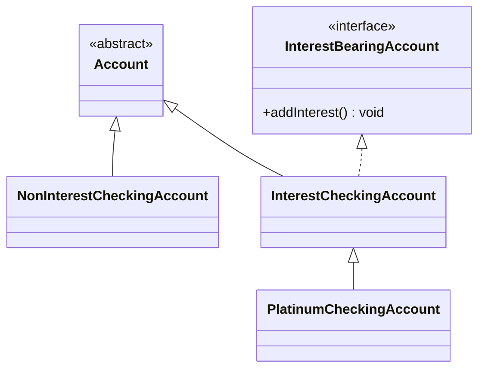

# Exercise 1 – Bank (inheritance, polymorphism and interfaces)

## Task

Given are the following five classes:

1. `Bank`
2. `Account`
3. `NonInterestCheckingAccount`
4. `InterestCheckingAccount`
5. `PlatinumCheckingAccount`

as well as an interface called `InterestBearingAccount`, which behave as follows:

- **`Bank`** stores a list of all types of accounts, including savings and checking accounts, some of which are subject to interest and some are not. It has a method `totalAssets` which returns the sum of the balances of all accounts. It also has a method `addInterest` which calls `addInterest` on all accounts that are subject to interest.
- **`Account`** is an abstract class. Each account stores the name of the account holder, the account number (a sequential number assigned automatically), and the current balance. The class implements a constructor for initializing the data members, methods for accessing the current balance, and methods for adding to and subtracting from the current balance.
- **`InterestBearingAccount`** is an interface that declares a single method `addInterest` (no parameters, returns `void`) which increases the balance by the appropriate interest rate for that type of account.
- **`InterestCheckingAccount`** is an `Account` which is also an `InterestBearingAccount`. Calling `addInterest` increases the balance by 3%.
- **`PlatinumCheckingAccount`** is an `InterestCheckingAccount`. Calling `addInterest` increases the balance by double the interest rate of `InterestCheckingAccount` (whatever that may be).
- **`NonInterestCheckingAccount`** is an `Account` but not an `InterestBearingAccount`. It has no functionality beyond the basic one from `Account`.

Five of the six types form a hierarchy. Draw this hierarchy, then:

1. Implement `Account`.
2. Implement `NonInterestCheckingAccount`.
3. Write the `InterestBearingAccount` interface.
4. Implement `Bank`.
5. Implement `InterestCheckingAccount`.
6. Implement `PlatinumCheckingAccount`.

---

## Solution

### Hierarchy

`Bank` is not part of the hierarchy. It only *uses* accounts (composition, not inheritance).

```
                 «abstract»                    «interface»
                  Account                 InterestBearingAccount
                 /       \                          |
                /         \                         | implements
               /           \                        |
NonInterestCheckingAccount  InterestCheckingAccount-+
                                       |
                                       |
                            PlatinumCheckingAccount
```



### 1. `Account`

```java
public abstract class Account {
    private static int nextAccountNumber = 1;

    private final String holderName;
    private final int accountNumber;
    private double balance;

    public Account(String holderName, double initialBalance) {
        this.holderName = holderName;
        this.accountNumber = nextAccountNumber++;
        this.balance = initialBalance;
    }

    public String getHolderName() {
        return holderName;
    }

    public int getAccountNumber() {
        return accountNumber;
    }

    public double getBalance() {
        return balance;
    }

    public void deposit(double amount) {
        balance += amount;
    }

    public void withdraw(double amount) {
        balance -= amount;
    }

    @Override
    public String toString() {
        return String.format("#%d %s: %.2f", accountNumber, holderName, balance);
    }
}
```

The `static` counter is shared by all instances, so each new account gets the next number automatically.

### 2. `NonInterestCheckingAccount`

```java
public class NonInterestCheckingAccount extends Account {
    public NonInterestCheckingAccount(String holderName, double initialBalance) {
        super(holderName, initialBalance);
    }
}
```

### 3. `InterestBearingAccount`

```java
public interface InterestBearingAccount {
    void addInterest();
}
```

### 4. `Bank`

```java
import java.util.ArrayList;
import java.util.List;

public class Bank {
    private final List<Account> accounts = new ArrayList<>();

    public void addAccount(Account account) {
        accounts.add(account);
    }

    public double totalAssets() {
        double total = 0;
        for (Account account : accounts) {
            total += account.getBalance();
        }
        return total;
    }

    public void addInterest() {
        for (Account account : accounts) {
            if (account instanceof InterestBearingAccount) {
                ((InterestBearingAccount) account).addInterest();
            }
        }
    }
}
```

`Bank` only knows about `Account` and `InterestBearingAccount`, never the concrete classes. A new interest-bearing account type would work without changing `Bank`.

### 5. `InterestCheckingAccount`

```java
public class InterestCheckingAccount extends Account implements InterestBearingAccount {
    private static final double INTEREST_RATE = 0.03;

    public InterestCheckingAccount(String holderName, double initialBalance) {
        super(holderName, initialBalance);
    }

    protected double getInterestRate() {
        return INTEREST_RATE;
    }

    @Override
    public void addInterest() {
        deposit(getBalance() * getInterestRate());
    }
}
```

### 6. `PlatinumCheckingAccount`

```java
public class PlatinumCheckingAccount extends InterestCheckingAccount {
    public PlatinumCheckingAccount(String holderName, double initialBalance) {
        super(holderName, initialBalance);
    }

    @Override
    protected double getInterestRate() {
        return super.getInterestRate() * 2;
    }
}
```

`addInterest` is inherited unchanged. Only the rate is overridden, and it is computed from the parent's rate (`super.getInterestRate() * 2`) instead of hard-coding 6%. That satisfies "double the rate, whatever that may be": if the base rate changes, Platinum follows automatically. When the inherited `addInterest` calls `getInterestRate()`, dynamic dispatch picks the overridden version.

### Usage example

```java
public class Main {
    public static void main(String[] args) {
        Bank bank = new Bank();
        bank.addAccount(new NonInterestCheckingAccount("Ana", 1000));
        bank.addAccount(new InterestCheckingAccount("Marko", 2000));
        bank.addAccount(new PlatinumCheckingAccount("Elena", 3000));

        System.out.printf("Before interest: %.2f%n", bank.totalAssets());
        bank.addInterest();
        System.out.printf("After interest:  %.2f%n", bank.totalAssets());
    }
}
```

Output:

```
Before interest: 6000.00
After interest:  6240.00
```

The total is 1000 (no interest) + 2000 × 1.03 + 3000 × 1.06 = 1000 + 2060 + 3180 = 6240.